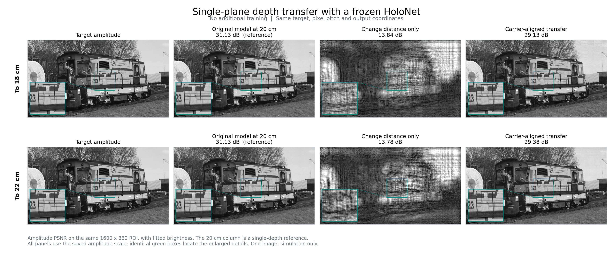
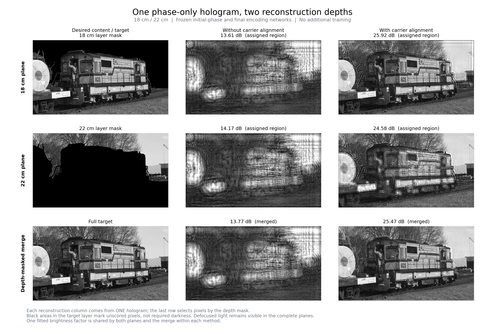
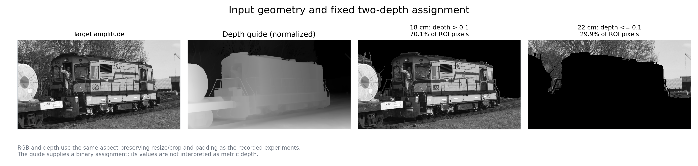
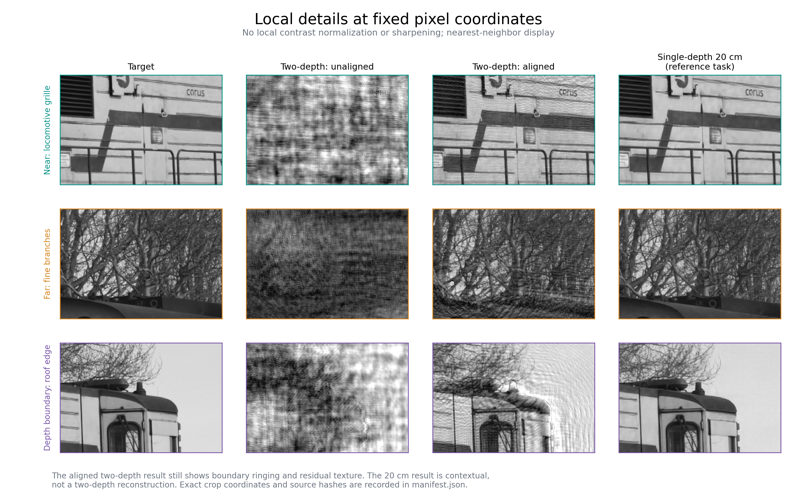
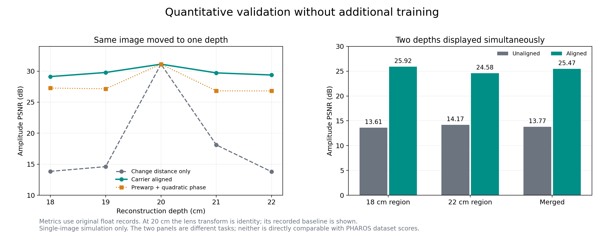

# 物理深度迁移：论文式结果展示

本展示参考用户提供的 PHAROS 论文（main.pdf）Fig. 6–8：按列并排展示方法，在同一位置放大细节，并标注对应指标。展示内容全部来自当前项目的已完成实验，没有使用论文中的重建图作为本项目结果。

本轮未训练。冻结的基础模型原先只针对 0031 图像、20 cm 单平面训练。所有图片均为标量衍射仿真，非相机实拍。

## 图 1：冻结模型向不同深度迁移

两行分别对应 18 cm 和 22 cm。四列为目标、原模型在 20 cm 的重建参考、直接更改反传距离、增加载波相位对齐。绿色框与放大图在所有方法中使用相同像素坐标。

对齐使 18 cm 从 13.84 提升至 29.13 dB，使 22 cm 从 13.78 提升至 29.38 dB。20 cm 的 31.13 dB 是原任务参考，不表示原模型同时具备两层显示能力。

## 图 2：一张相位同时重建两个深度

第一、二行是同一张全息相位在 18 cm、22 cm 的完整重建；第三行按深度分区拼接。每个方法的两层与拼接共用同一亮度尺度。

左列黑色区域表示该平面不评价的像素，不代表要求它完全没有光。近景在远平面离焦、远景在近平面离焦应当从完整平面观察，不能仅凭拼接图判断。

| 方法 | 18 cm 对应区域 | 22 cm 对应区域 | 拼接 |
| --- | ---: | ---: | ---: |
| 未对齐 | 13.61 | 14.17 | 13.77 |
| 载波对齐 | 25.92 | 24.58 | 25.47 |

对齐明显改善了冻结编码器的结果，但分区边界的振铃和离焦串扰仍然存在。25.47 dB 尚未达到基础单平面 31.13 dB 的水平；两者任务也不同。

## 图 3：输入与分层依据

RGB 与 depth 使用与原实验一致的缩放、裁剪与补零。深度图归一化后，depth > 0.1 对应 18 cm，其余对应 22 cm。数值仅用于分区，不把深度图数值直接解释为米。

## 图 4：相同区域的细节比较

三行固定展示近景车身格栅、远景树枝和车顶深度边界。没有局部直方图拉伸、锐化或对比度增强；放大采用最近邻显示。原 20 cm 图像作为单深度任务参考单列展示。

## 图 5：定量结果

左图比较单平面迁移，右图比较同时双平面显示，两个任务分别作图。透镜相位路线包含输入空间预变形；在相同坐标下与原目标比较，零训练约 26.8–27.3 dB。

20 cm 时预变形与透镜相位均退化为恒等变换，因此该点使用透镜实验已记录的基础模型结果 31.13 dB。曲线连线用于连接采样点，不表示已评估其间所有深度。

## 指标与可复核性

- 输入宽×高 1920×1072；评价 ROI 1600×880；波长 520 nm；像素间距 6.4 μm。
- 图上 PSNR 来自原始浮点结果 JSON，先在 ROI 做统一最小二乘亮度匹配，峰值取 1。
- 展示图来自实验保存的 8-bit 振幅 PNG。没有由 PNG 重新计算 PSNR，也没有把显示图当作线性强度或 RGB 图。
- 没有计算或虚构 SSIM、LPIPS 等指标。没有将本单图过拟合结果与论文的数据集平均 PSNR 横向排名。
- 各图 PNG/PDF 位于 figures，整套图的 PDF 为 results_figures.pdf。
- 完整物理报告为 physics_proof.md / physics_proof.pdf，含传播假设、推导、实验及限制。
- 原始指标快照、CSV 和分区掩码位于 data；来源路径、SHA-256 和局部裁剪坐标保存在 manifest.json。
- build_presentation.py 只读取已保存图像和指标，不运行推理或训练；render_documents.py 生成文档。

来源实验为 test/experiments/20261103_150411_encoder_gauge、20261103_110638_depth_physics 和 20261103_150105_quadratic_depth，路径均相对于 neural-holography-mini。
